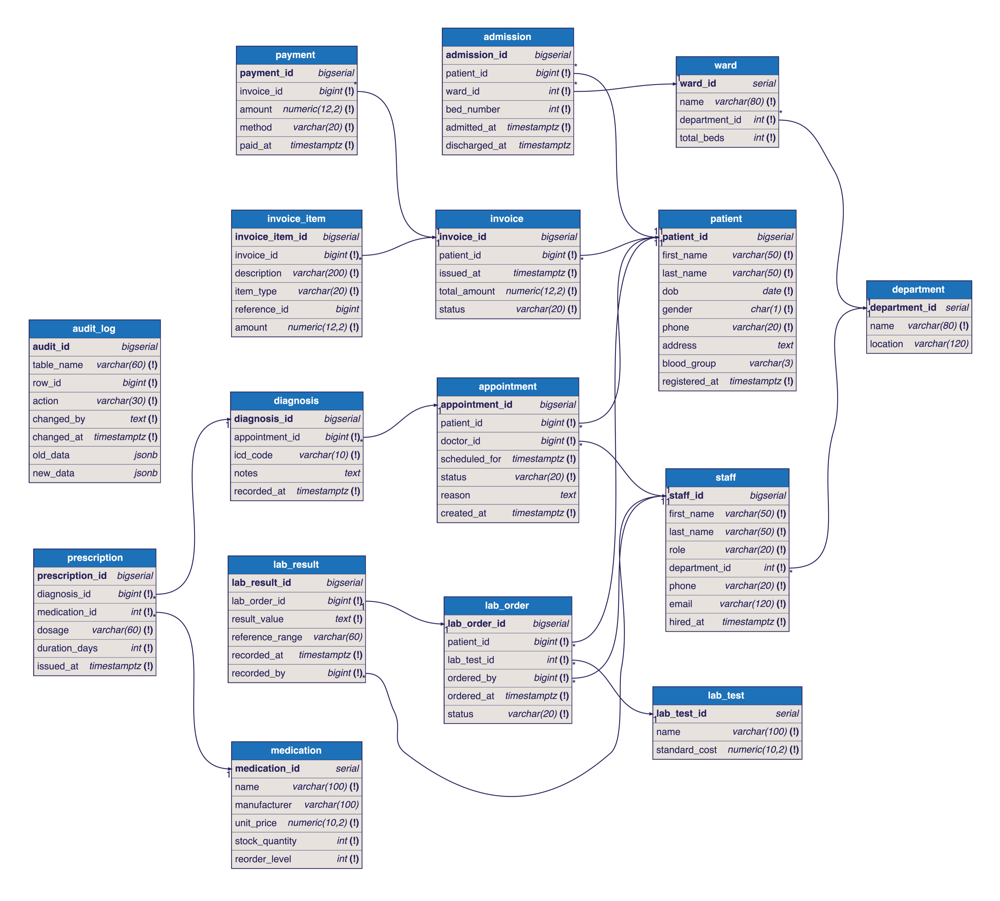
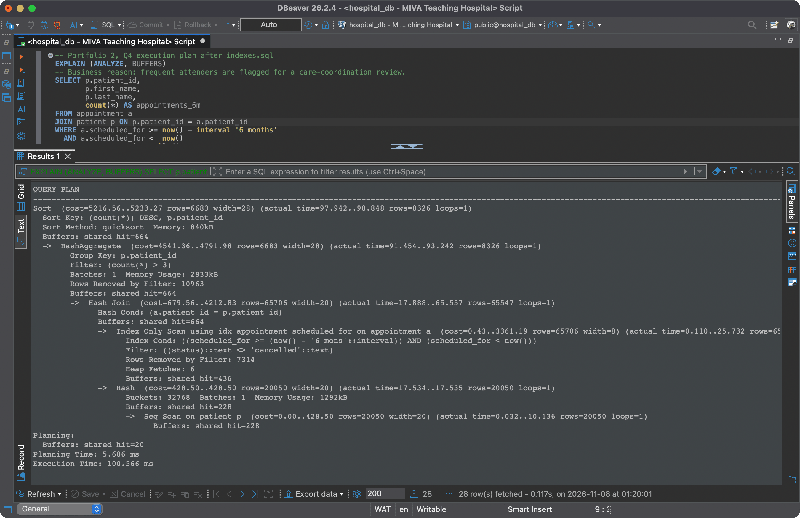
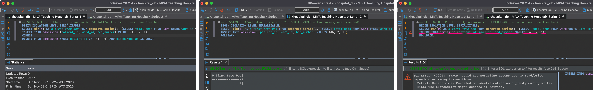
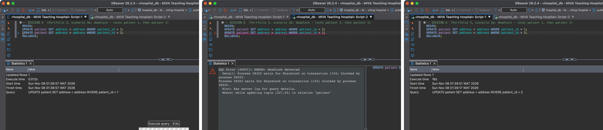
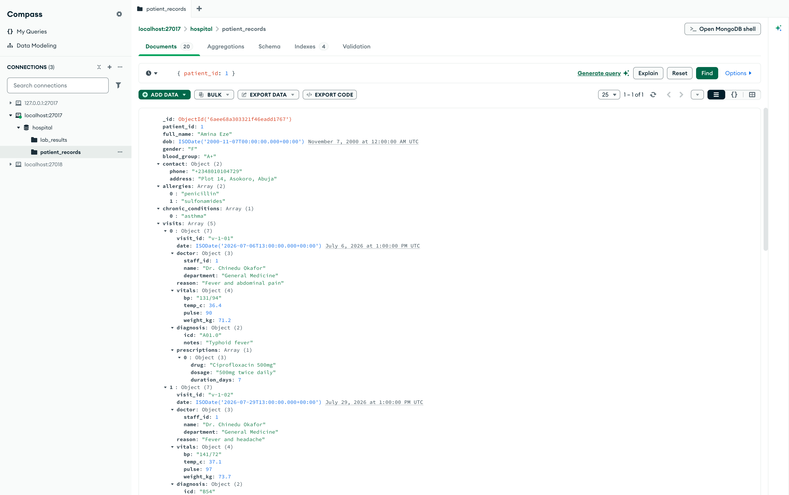
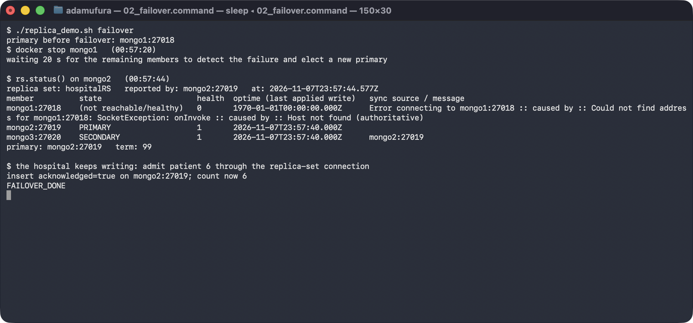

<!-- PAGE 1 -->

# 1. Student and Submission Details

| | |
|---|---|
| **Student** | Zarah Garba Ali |
| **Student ID** | 301918521 |
| **Email** | a.garba8521@miva.edu.ng |
| **Programme / Course** | Master of Information Technology - MIT 8103 Advanced Database Systems |
| **Cohort** | September 2026 |
| **GitHub repository (private, assessor added as collaborator)** | <https://github.com/Zarahgarbaali/mit8103-hospital-portfolio> |

# 2. Selected Case Study

**Organisation:** MIVA Teaching Hospital, a simulated mid-size general hospital in Abuja, Nigeria.

**Nature of the business:** outpatient consultations, inpatient admissions, laboratory diagnostics, pharmacy dispensing and billing, running 24/7 across five departments (General Medicine, Paediatrics, Obstetrics and Gynaecology, Surgery, Clinical Support Services).

**Users of the database:** receptionists (register patients, book appointments), doctors (patient history, diagnoses, prescriptions), nurses (vitals, admissions), lab technicians (test results), pharmacists (dispensing, stock), billing officers (invoices, payments) and administrators (reports, audit).

**Major data stored:** patients, staff, departments, appointments, diagnoses, prescriptions, lab tests, orders and results, medications and stock, wards, beds and admissions, invoices, invoice items, payments and an audit log.

**Key operations:** register a patient; book, reschedule and cancel appointments; record a consultation with diagnosis and prescription; order a lab test and attach its result; admit and discharge a patient; dispense medication and decrement stock; invoice and take payment; produce daily, revenue and stock reports.

The same hospital, patients and doctors are used in all five portfolio activities.

# 3. Portfolio Overview

**Portfolio 1 - Database Design and Modelling.** A 16-table PostgreSQL 16 schema (ER diagram in DBML and Mermaid). It uses surrogate keys, `TIMESTAMPTZ`, CHECK / UNIQUE / NOT NULL constraints, `ON DELETE RESTRICT` on every clinical reference, and partial unique indexes that allow only one current patient per bed. Triggers enforce rules a CHECK cannot express, such as "an appointment's doctor must be a doctor" and "a payment may not exceed the invoice total". The seed is reproducible (`setseed`), 12 constraint tests prove the rules reject bad data, and the normalisation write-up walks from 1NF to BCNF with two documented, controlled exceptions.

**Portfolio 2 - Query Processing and Optimisation.** Ten business queries were run against about 1.5 million rows of generated activity, with `EXPLAIN (ANALYZE, BUFFERS)` captured before and after indexing. Range and covering indexes made Q2 6.7x faster (13.6 to 2.0 ms) and turned Q4 into an index-only scan. Partial indexes made Q3 and Q5 roughly 1.5-1.7x faster. A materialised view cut monthly revenue reporting from 102 ms to 0.03 ms. The analysis also reports what did *not* work: an index that made Q3 slower until a companion index was added, and queries that no index could fix. It measures the write cost: inserts were 33% slower with the extra indexes.

**Portfolio 3 - Transactions and Concurrency.** COMMIT, ROLLBACK, SAVEPOINT and whole-transaction rollback on an overpayment. Five two-session isolation scenarios were run concurrently and logged. They show no dirty reads under READ COMMITTED; repeatable reads and a refused lost update under REPEATABLE READ; and SERIALIZABLE refusing both a double-booked bed and a write-skew double booking that READ COMMITTED allowed. Also covered: a reproduced deadlock and the lock-ordering fix, `FOR UPDATE` on the last pack of insulin, `NOWAIT`, `SKIP LOCKED` as a lab work queue, and a `discharge_patient` stored procedure with a JSONB audit trail.

**Portfolio 4 - NoSQL and Advanced Data Models.** MongoDB 7 holds patient charts with embedded visits, diagnoses and prescriptions, and lab results whose `results` shape differs per test type. `$jsonSchema` validation, unique and multikey indexes, and six queries (`findOne`, `$push`, multikey match, `$unwind`/`$group`, `$avg`, `$lookup`) are verified with `explain()`. The suitability analysis explains why the chart moved to documents while billing stays relational.

**Portfolio 5 - Distributed and Cloud Database Exercise.** A three-node MongoDB replica set in Docker. Majority writes on the primary are read back from secondaries with 0 s lag. Stopping the primary triggered an automatic election, the old primary rejoined, caught up and failed back, and a minority partition refused writes (CP behaviour). The discussion covers sharding key choice, CAP for the admissions desk, consistency models and PostgreSQL streaming replication.

<!-- PAGE 2 -->

# 4. Evidence Summary

| Portfolio | Key evidence (in the repository) |
|---|---|
| 1 | ER diagram; `evidence/row_counts.txt`; `evidence/constraint_tests_output.txt` (12/12 rules enforced) |
| 2 | `execution_plans/before/` and `after/` (10 plans each, with summary); `performance_analysis.md`; materialised view and write-cost outputs |
| 3 | `evidence/01_commit_rollback_output.txt`; `evidence/2a`-`2e` isolation logs; `3a` deadlock; `4a`-`4c` locking; `05_discharge_procedure_output.txt` |
| 4 | `evidence/seed_output.txt` (validator rejection); `evidence/queries_output.txt` (all queries with plans) |
| 5 | `evidence/01`-`06` replica set status, read/write, failover, rejoin, minority partition |

{ width=48% }
{ width=48% }

{ width=48% }
{ width=48% }

{ width=48% }
{ width=48% }

# 5. Technical Reflection

> **TODO (Zarah):** write 3-4 paragraphs in your own words. Cover:
>
> 1. **What you designed and why.** Focus on one or two hospital areas (for example, beds and admissions, or billing) rather than the whole portfolio.
> 2. **A concrete problem you hit and how you solved it.** Pick one real moment from the work (an index that made Q3 slower, the patient-ID gap that broke the bulk load, the deadlock victim not being the one the guide predicted, the SERIALIZABLE error appearing at commit rather than insert, or the Q9 rewrite that was slower).
> 3. **What you learned about PostgreSQL vs MongoDB for different parts of the hospital.** Be specific: "Billing stayed in Postgres because..." and "Patient history moved to Mongo because..."
> 4. **What you would do differently with more time.** For example: sharding, connection pooling, scheduling the materialised view refresh with pg_cron, storing `amount_paid` on `invoice`, or securing the replica set with a keyfile.

<!-- PAGE 3 -->

# 6. Tools and References

**Tools:** PostgreSQL 16.15, MongoDB 7.0, Docker Desktop, DBeaver, MongoDB Compass, mongosh, dbdiagram.io, Git and GitHub. All datasets were produced by the scripts in the repository. No external datasets were used.

**References**

1. Elmasri, R. and Navathe, S. B. (2016). *Fundamentals of Database Systems*, 7th edn. Pearson.
2. PostgreSQL Global Development Group (2024). *PostgreSQL 16 Documentation*: Chapter 11 Indexes; Chapter 13 Concurrency Control (13.2 Transaction Isolation, 13.3 Explicit Locking); Chapter 14 Performance Tips (14.1 Using EXPLAIN); CREATE MATERIALIZED VIEW; Chapter 27 High Availability, Load Balancing, and Replication. <https://www.postgresql.org/docs/16/>
3. Ports, D. R. K. and Grittner, K. (2012). Serializable Snapshot Isolation in PostgreSQL. *Proceedings of the VLDB Endowment*, 5(12), pp. 1850-1861.
4. MongoDB, Inc. (2024). *MongoDB 7.0 Manual*: Data Modeling; Schema Validation; Indexes (Multikey); Aggregation Pipeline; Replication; Read Concern and Write Concern; Sharding. <https://www.mongodb.com/docs/v7.0/>
5. Brewer, E. (2012). CAP Twelve Years Later: How the "Rules" Have Changed. *Computer*, 45(2), pp. 23-29.
6. Kleppmann, M. (2017). *Designing Data-Intensive Applications*. O'Reilly Media. Chapters 5 (Replication), 6 (Partitioning) and 7 (Transactions).
7. Federal Republic of Nigeria (2023). *Nigeria Data Protection Act 2023*.
8. MIVA Open University (2026). *MIT 8103 Advanced Database Systems course material*, Study Sessions 1-6.

# 7. Declaration of AI and Tool Use

I, Zarah Garba Ali (Student ID 301918521), used Cursor and Claude to support this work in the following ways: understanding concepts, drafting initial SQL and Mongo scripts which I then edited and tested, explaining execution plans, and reviewing my writeups for clarity. All design decisions — the choice of case study, the schema design, the index choices, the isolation walkthroughs, the Mongo modelling, the replica set setup, and the written reflection — are my own. All code was executed, verified, and in several places rewritten by me after testing. No AI-generated text was submitted without review.

# 8. Individual Work Statement

I confirm that this portfolio is my own individual work. I discussed general concepts only, and the database design, implementation, scripts, analysis, documentation and conclusions submitted here were produced by me. All sources, tools and libraries used are acknowledged above.

Signed: Zarah Garba Ali, Student ID 301918521. Date: ____________
