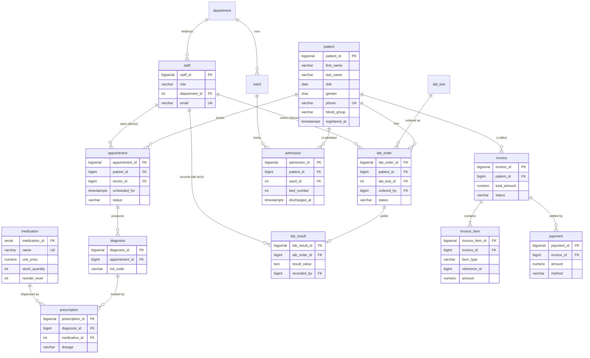

# Portfolio 1 - Database Design and Modelling

Relational design for **MIVA Teaching Hospital**, implemented in PostgreSQL 16.

## Case study

**Organisation:** MIVA Teaching Hospital (a simulated mid-size hospital in Abuja, Nigeria).

**Nature of the business:** A general hospital offering outpatient consultations, inpatient admissions, laboratory diagnostics, pharmacy dispensing, and billing. The hospital runs 24/7 across multiple departments.

**Users of the database:**
- Receptionists (register patients, book appointments)
- Doctors (view patient history, record diagnoses, issue prescriptions)
- Nurses (record vitals, update admission status)
- Lab technicians (enter test results)
- Pharmacists (dispense medication, update stock)
- Billing officers (generate invoices, record payments)
- Hospital administrators (reports, audit)

**Major data stored:** Patients, staff (doctors, nurses, lab technicians, pharmacists), departments, appointments, diagnoses, prescriptions, lab tests and results, medications and stock, admissions, wards and beds, invoices, payments, audit logs.

**Key operations:**
- Register a new patient and store demographics
- Book, reschedule, and cancel appointments
- Record a consultation with diagnosis and prescription
- Order a lab test and attach its result to a patient record
- Admit and discharge a patient from a ward
- Dispense medication and decrement stock
- Generate an invoice and record payment
- Produce reports (daily appointments, revenue, stock alerts)

## Files

| File | Purpose |
|---|---|
| `er_diagram.dbml` | ER model source. Paste into [dbdiagram.io](https://dbdiagram.io) to render. |
| `er_diagram.png` | Exported ER diagram |
| `schema.sql` | 16 tables, keys, CHECK / UNIQUE / NOT NULL constraints, business-rule triggers |
| `indexes.sql` | Indexes on every foreign key, plus the `(doctor_id, scheduled_for)` composite |
| `seed.sql` | Reproducible seed data (`setseed(0.42)`) |
| `constraint_tests.sql` | 12 tests that try to break the rules and must be rejected |
| `normalisation.md` | 1NF to BCNF walkthrough |
| `evidence/` | Row counts, index list, constraint test output |
| `screenshots/` | DBeaver schema tree and row counts |

## ER diagram

The exported diagram is `er_diagram.png`. The same model in Mermaid (GitHub renders this inline):



`audit_log`, `lab_test`, `ward` and `department` are omitted from the attribute boxes for space. See `er_diagram.dbml` for every column.

## Key design decisions

- **Surrogate keys.** `BIGSERIAL` on the high-volume tables (patient, appointment, lab_order and the other clinical and billing tables), `SERIAL` on small catalogues (department, medication, lab_test, ward). Natural keys such as phone and email are still enforced with `UNIQUE`.
- **`TIMESTAMPTZ` everywhere.** The hospital runs 24/7, and timestamps must stay correct across night shifts and any future multi-site setup.
- **Never lose medical records.** Every foreign key that points at a patient or a clinical record is `ON DELETE RESTRICT` (test T5). The only `ON DELETE CASCADE` is `invoice_item -> invoice` (test T11), because an item means nothing without its invoice.
- **Rules on open admissions use partial unique indexes.** `uq_admission_open_bed` (one current patient per bed) and `uq_admission_open_patient` (a patient is on one bed at a time) apply only `WHERE discharged_at IS NULL`, so discharged history is unaffected (test T6).
- **Triggers for rules a CHECK cannot express.** These cover cross-table rules: an appointment's `doctor_id` must be a doctor (T4), a bed must exist in its ward (T7), a payment cannot exceed the invoice total (T10), and `invoice.total_amount` always equals the sum of its items (T12).
- **Indexes on every foreign key.** PostgreSQL does not create these automatically. Without them, joins and `RESTRICT` checks would scan whole tables.

## How to run

From the repository root, with `docker/docker-compose.yml` running:

```bash
docker exec -i hospital_pg psql -U hospital_admin -d hospital_db -v ON_ERROR_STOP=1 -f /workspace/portfolio-1-database-design/schema.sql
docker exec -i hospital_pg psql -U hospital_admin -d hospital_db -v ON_ERROR_STOP=1 -f /workspace/portfolio-1-database-design/indexes.sql
docker exec -i hospital_pg psql -U hospital_admin -d hospital_db -v ON_ERROR_STOP=1 -f /workspace/portfolio-1-database-design/seed.sql
docker exec -i hospital_pg psql -U hospital_admin -d hospital_db -f /workspace/portfolio-1-database-design/constraint_tests.sql
```

The repo is mounted read-only at `/workspace` inside the container, so no files need copying. The scripts can also be opened and run in DBeaver, except `constraint_tests.sql`, which uses psql `\gset` variables.

## How it was tested

1. `schema.sql` and `indexes.sql` load with no errors. `\dt` lists 16 tables.
2. `seed.sql` loads and produces the expected row counts (`evidence/row_counts.txt`). Running it twice gives identical MD5 hashes of the patient, appointment and invoice data, which shows that `setseed` makes the seed reproducible.
3. `constraint_tests.sql` runs 12 violations. Every one is rejected with the expected error, and the two positive tests (T11 cascade, T12 total trigger) show the intended change (`evidence/constraint_tests_output.txt`).

## Evidence

- `evidence/row_counts.txt` - row count per table and the full index list
- `evidence/constraint_tests_output.txt` - output of the 12 constraint tests
- `screenshots/01_schema_loaded.png` - DBeaver schema tree showing all 16 tables
- `screenshots/02_row_counts.png` - row counts in DBeaver
