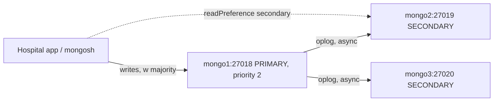

# Portfolio 5 - Distributed and Cloud Database Exercise

A three-node MongoDB replica set (`hospitalRS`) for **MIVA Teaching Hospital**, running in Docker. It demonstrates replication, automatic failover, rejoin and catch-up, and the CAP behaviour of a minority partition. `discussion.md` covers replication, sharding, CAP, consistency models and PostgreSQL streaming replication.

## Files

| File | Purpose |
|---|---|
| `docker/docker-compose.yml` | `mongo1`, `mongo2`, `mongo3` on ports 27018, 27019, 27020 with `--replSet hospitalRS` |
| `replica_demo.sh` | One subcommand per milestone; each writes its evidence file |
| `discussion.md` | Replication, sharding design, CAP, consistency, PostgreSQL streaming replication, why local Docker |
| `evidence/` | Output of every step |
| `screenshots/` | Failover terminal and Compass topology |

## Topology



## What was demonstrated

| Step | Command | Result | Evidence |
|---|---|---|---|
| Initiate | `./replica_demo.sh init` | `hospitalRS` created, `mongo1` PRIMARY (term 1) | `01_rs_status.txt` |
| Baseline | `./replica_demo.sh status` | 1 PRIMARY + 2 SECONDARY, both syncing from `mongo1` | `01_rs_status.txt` |
| Write / read | `./replica_demo.sh write-read` | 5 records written with `w: majority`. Both secondaries return 5, lag 0 s. A direct write on a secondary is refused (`NotWritablePrimary`) | `02_write_primary.txt`, `03_read_secondary.txt` |
| Failover | `./replica_demo.sh failover` | `docker stop mongo1`, then `mongo2` elected PRIMARY (term 99). Writes continue (patient 6) | `04_failover_rs_status.txt` |
| Rejoin | `./replica_demo.sh rejoin` | `mongo1` rejoins as SECONDARY, catches up (has patient 6), and after about 10 s retakes PRIMARY thanks to priority 2 (term 100) | `05_rejoin_rs_status.txt` |
| Minority partition | `./replica_demo.sh minority` | With 2 of 3 members down, `mongo1` steps down: no primary, writes refused, reads still served. A primary returns when they restart (term 101) | `06_minority_no_primary.txt` |

The term number counts elections. It jumped from 6 to the high 90s because the set stayed up for a day and held elections on its own at irregular times. The container logs show over 30 elections per member, most likely when the Mac slept or Docker Desktop paused its VM and heartbeats timed out. The failover, rejoin and minority steps were re-run on 8 November, when the screenshot was taken, so the evidence files and screenshot match.

## How to run

```bash
cd portfolio-5-distributed-cloud/docker
docker compose up -d
cd ..
./replica_demo.sh init
./replica_demo.sh status
./replica_demo.sh write-read
./replica_demo.sh failover
./replica_demo.sh rejoin
./replica_demo.sh minority
```

The replica set runs alongside the Portfolio 1-4 stack (`hospital_pg`, `hospital_mongo`). The two stacks use different ports and do not interfere.

Deviations from the original plan:

- `mongo1` has `priority: 2`, so the rejoin step also shows a planned failback, not only catch-up.
- The extra `minority` step gives direct evidence for the CAP discussion.
- Ports are bound to `127.0.0.1` and authentication is off (see the note in the compose file).

### MongoDB Compass

The member names inside the replica set config are `mongo1`, `mongo2` and `mongo3`, so the Mac must be able to resolve them:

```bash
sudo sh -c 'echo "127.0.0.1 mongo1 mongo2 mongo3" >> /etc/hosts'
```

Then connect Compass to `mongodb://mongo1:27018,mongo2:27019,mongo3:27020/?replicaSet=hospitalRS`.

## Screenshots

- `screenshots/01_failover_terminal.png` - terminal output of `./replica_demo.sh failover` showing `mongo2` as PRIMARY
- `screenshots/02_compass_replica_set.png` - Compass connected to `hospitalRS`, showing the 3-member topology
